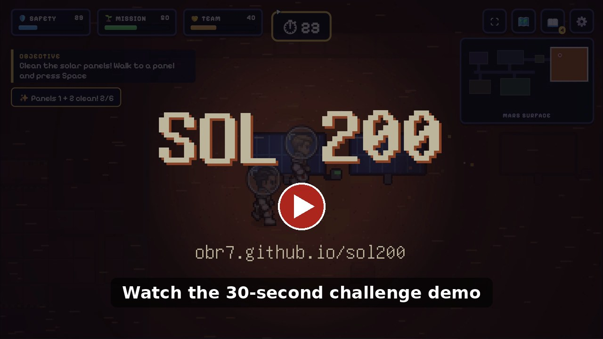

<div align="center">

# 🔴 SOL 200
### Junior Astronaut Mission Trainer

**A story game about surviving, leading and growing food on Mars, for kids aged 7 to 12.**

### 🎬 Challenge demo (30 seconds)

[](https://obr7.github.io/sol200/docs/demo/SOL200_demo.mp4)

**This is our official 30-second demo for the NASA Space Apps 2026 challenge.** Click the image to play it, or [open the video file](docs/demo/SOL200_demo.mp4).
<sub>Voice-over made with ElevenLabs (AI). Footage is recorded from the game itself.</sub>


[▶ **Play now**](https://obr7.github.io/sol200/) · [📖 The story](docs/STORY.md) · [🎬 Game script](docs/full-game-script-en.md) · [🛠 Documentation](docs/DOCUMENTATION.md)

   

</div>

---

SOL 200 is a free browser game made for the **NASA Space Apps Challenge 2026** challenge *Junior Astronaut Mission Trainer*.

You play **Commander Damon Carter** on Sol 200 (day 200) of the first mission to grow food on Mars. A giant dust storm is coming, and the crew does not agree on what to do. You explore the base, play short hands-on mini-games built on real science, and make hard choices. Every choice has a price on three meters: **Safety**, **Mission** and **Team**.

> ### 🎧 Vibe coded from start to finish
> **This whole project is vibe coding.** Our team did not write the code by hand. We described what we wanted in plain language (the story, the scenes, the mini-games, how things should look and feel), and AI tools wrote all of the code. We played every version, said what to change, and checked every result. The story, characters, game design and science choices are ours. See [AI use](#ai-use) below.

## At a glance

**The problem.** Most space games for kids teach facts only. Real astronauts also train to make decisions under pressure and to work as a team, and NASA treats poor teamwork as a real risk on long missions. Children rarely get a chance to practice these skills in a space setting.

**Our solution.** A story game where every mission links three things: a real fact leads to a hard decision with a cost, and the decision leads to a feeling the crew lives through.

**NASA data and sources at the heart of the game, in three layers:**

1. **Live data:** the game reads today's real solar activity from NASA's space weather database (DONKI), and it changes how dangerous it is to go out into the storm. Real space weather changes the child's decision. The game also uses NASA's Mars maps (Mars Trek) on the 3D Mars globe, and a real photo taken by the Curiosity rover in the Crew Quarters window.
2. **Five mini-games built on NASA science:** growing plants in space, Mars dust on solar panels, spacesuits, limited power, and making oxygen from Martian air. Details are in [NASA in every mission](#nasa-in-every-mission).
3. **Thirteen discovery cards:** each card is a real fact with a link to its source, and most sources are from NASA.

**Who is it for?** Children aged 7 to 12, and their parents and teachers. It is free, runs in any browser, and needs no account.

**The psychological side.** The four crew members are four sides of one person: Body, Mind, Psyche and Soul. Every moment in the game trains a social and emotional skill.

## Contents
[At a glance](#at-a-glance) · [The story](#the-story) · [Chapter 1](#whats-in-chapter-1) · [Real NASA data](#real-nasa-data-used-while-you-play) · [NASA in every mission](#nasa-in-every-mission) · [A person in four sides](#a-person-in-four-sides) · [Why feelings?](#why-feelings) · [AI use](#ai-use) · [Run it](#run-it) · [Build](#build) · [Credits](#credits)

## The story

> Four astronauts who know each other from Earth face crises on Mars while a shared secret from their past surfaces. **The central question: does Damon deserve to lead?**

| # | Chapter | You play | The choice | Lesson | Status |
|---|---|---|---|---|---|
| 1 | The Commander | Damon | Clean the panels outside (A) or stay in and share power (B) | Leaders listen; asking for help is not weakness | ✅ Playable |
| 2 | Damon's Past | Damon | Claim the credit (A) or share it with Marcus (B) | Shortcuts have a cost | 📝 Planned |
| 3 | Marcus | Marcus | Send the full honest report (A) or hide the painful parts (B) | Silence isn't innocent | 📝 Planned |
| 4 | Diego | Diego | Admit the water leak and repair fully (A) or keep the quick patch (B) | Half-solutions only delay problems | 📝 Planned |
| 5 | Layla | Layla | Save Hope (A) or protect the crew's water (B) | When a mistake comes out, help comes, not punishment | 📝 Planned |
| 6 | The Sun | All four | Build a radiation shelter together during a solar flare | Teamwork decides what survives | 📝 Planned |

- **Threads:** Earth's question "who made the decisions?", the secret of a past training accident, and the Team meter that decides the ending.
- **Endings:** with Team trust at 50 or more, the crew opens up and sends one honest report; below 50, accusations fly and they part ways, never speaking again.
- **Foreshadowing:** radiation from a solar flare is Chapter 6's climax, and Chapter 1 already reads live NASA DONKI data to show today's real Sun.

Full outline with every chapter: **[docs/STORY.md](docs/STORY.md)** · Full game script (all 6 chapters): **[docs/full-game-script-en.md](docs/full-game-script-en.md)**

## What's in Chapter 1

- **A narrated intro film** (about 78 seconds, with a Skip button): the crew argues, the rocket launches, the crew lands on Mars.
- **A Mars base to explore**: 5 rooms (Crew Quarters, Control Room, Workshop, Greenhouse, Airlock) and the Mars surface outside, with Among Us-style room lighting and a minimap.
- **13 discovery cards**: objects with a small "?" bubble open a real science card with its source link. All cards are collected in the Discovery Journal.
- **5 mini-games**, each based on real science:

| Mini-game | What you do | The real science |
|---|---|---|
| Garden Check | Use water, a grow lamp and a heater to keep 3 plants healthy. Too much damages the leaves. | NASA's Veggie plant chamber on the ISS |
| Clean the Panels | 3 jobs on 3 pairs of solar panels: brush the dust, flick off pebbles, tilt toward the Sun | Dust lowers solar power on Mars (InSight, Opportunity) |
| Suit Up | A spacesuit briefing card and a card about a real Jordanian spacesuit engineer, then dress the astronaut in checklist order and do a leak check | Spacesuits are small pressurized spaceships |
| Storm Night | Share 6 power units between oxygen, heat, garden, lights and radio until sunrise. Wind gusts cut power, overloading trips the breaker | Power is limited on Mars |
| Restart Rosie | Reconnect the oxygen machine's wires and watch CO₂ become O₂ | NASA's MOXIE made oxygen from Mars air |

- **Two big decisions**: go outside in the storm or stay safe inside; fix the oxygen machine alone or ask Marcus for help. Choosing to go alone makes the Rosie puzzle harder, and Marcus steps in if you fail.
- **Characters with feelings**: faces change with what they say (calm, happy, worried, scared, sad, angry, hurt).
- **An ending** chosen by the Team meter, a message from Earth, and a "what did you learn?" screen.

## Real NASA data used while you play

| Data | Where it appears in the game |
|---|---|
| [NASA DONKI](https://ccmc.gsfc.nasa.gov/tools/DONKI/) solar flares, read live through [NASA Open APIs](https://api.nasa.gov/) | Space Weather console and the "Clean the Panels" brief: a Calm / Busy / Stormy Sun meter decides how much Safety going outside costs. If the API cannot be reached, a real archived DONKI record is shown and labelled. |
| [NASA Mars Trek](https://trek.nasa.gov/mars/) map tiles (Viking MDIM 2.1 colour mosaic) | The 3D Mars globe on the Control Room hologram table, with 6 places to visit (Olympus Mons, Valles Marineris, Gale, Jezero, Hellas, North Polar Cap) |
| [NASA Image and Video Library, PIA20843](https://images.nasa.gov/details/PIA20843) (Curiosity) | The view from the Crew Quarters window |
| NASA, ESA and CSA science pages | The 13 discovery cards and the mini-game cards. Full list: [docs/DOCUMENTATION.md](docs/DOCUMENTATION.md#sources) |

Game numbers (meter points, timers, power units) are **game balance**, not real measurements.

## NASA in every mission

Every mini-game is built on real NASA science, and at the same time trains a psychological skill. This is where fact, decision and feeling meet.

| Mini-game | What the child does | The real NASA science | The skill it trains |
| --- | --- | --- | --- |
| Garden Check | Gives three plants the right amount of water, light and warmth, because too much harms the leaves | NASA's vegetable-growing chamber on the International Space Station ([Veggie](https://www.nasa.gov/wp-content/uploads/2019/04/veggie_fact_sheet_508.pdf)) | Self-management: patience, and caring for a living thing |
| Clean the Panels | Clears dust off the solar panels in the storm before time runs out | Dust cut the power of the InSight and Opportunity rovers ([InSight](https://www.nasa.gov/solar-system/nasas-insight-sees-power-levels-stabilize-after-dust-storm/)) | Responsible decision-making: going out has a cost, and today's real Sun changes the danger |
| Suit Up | Puts on the spacesuit in checklist order, then runs a leak check | A spacesuit is a small spacecraft that holds pressure, oxygen and temperature | Self-management: following steps under pressure |
| Storm Night | Splits six power units between oxygen, heating, the garden, lights and the radio until morning | In a 2008 storm, NASA's team turned off some of the Spirit rover's heaters and cut its communications to save power | Responsible decision-making: balancing everyone's needs |
| Restart Rosie | Reconnects the oxygen machine's wires and watches carbon dioxide turn into oxygen | NASA's experiment that made oxygen from Martian air on the Perseverance rover ([MOXIE](https://www.nasa.gov/missions/mars-2020-perseverance/perseverance-rover/nasas-oxygen-generating-experiment-moxie-completes-mars-mission/)) | Relationship skills: asking Marcus for help, or working alone |

**The thirteen discovery cards.** Around the base, objects marked with a question mark each open a card with a real fact and a link to its source. The cards cover dust storms, solar power, Mars gravity, the length of a Martian day, Martian air, why Mars is red, making oxygen, farming in space, Martian soil, solar storms that reach Mars, space weather, talking to Earth, and the value of every drop of water. Most sources are from NASA, and some are from its partners, the European and Canadian space agencies.

## A person in four sides

The four crew members are not just four characters. They are four sides of one person, and the mission only succeeds when they work together, which is what happens inside each of us.

| Character | Side | What they stand for | Their fear | Their lesson |
| --- | --- | --- | --- | --- |
| Damon, Commander | Body | Action and risk; he always says he can handle anything | Not deserving to lead, so he tries to prove himself by taking risks | Courage is not recklessness, and the body has limits to respect |
| Marcus, Deputy Commander | Mind | Thinking, planning and data | Being ignored again, so he hides his anger | Careful planning saves people, but being right is not enough, and staying silent about a mistake is not innocent |
| Diego, Mechanical Engineer | Psyche | Feelings, relationships and how we hide them; he hides his pain behind jokes | Confrontation | Half-solutions only postpone the problem; face your feelings and admit your mistake |
| Layla, Botanist and Spacesuit Expert | Soul | Meaning, values and hope; she named her plant "Hope" after her grandmother | Loss: when her grandmother fell ill, her soul dimmed and she stayed silent about a mistake | When a mistake comes out, help comes, not punishment, and broken things can hold new life |

**The three meters follow the same idea.** The Safety meter is the Body, the Mission meter is the Mind, and the Team meter is Psyche and Soul together. The Team meter, not the facts, decides the ending: at 50 or more, the crew stays together. In Chapter 6 all four work together for the first time, and that is the whole person.

**Where upbringing comes in.** Each character has a childhood scene at age 11, the player's own age, that shows how their upbringing shaped the problem they carry as adults:

- **Damon:** the second son nobody noticed, so he learned to take risks to be seen.
- **Marcus:** he learned precision from his father, and a friend took the credit for his work.
- **Diego:** his family emigrated and he was bullied at school, so he learned to hide his pain with jokes.
- **Layla:** she broke her grandmother's jar and hid it. Her grandmother said, "It's okay, habibti. What happened, happened. Come, let's fix it together," then planted mint in the glued jar. Layla learned that broken things can hold new life. When her grandmother fell ill, Layla's soul dimmed: she read the incomplete report about a training accident and stayed silent. Then her grandmother died before Layla could say goodbye, leaving her seeds and the glued jar itself. Layla planted the seeds on Mars and named the plant "Hope." In the end, she confesses to Damon what she kept silent about, and says her grandmother's words to him.

The message for parents and teachers: what a child lives through at 11 becomes the decisions they make as adults.

Note: only Chapter 1 is playable for now. The childhood scenes are written in Chapters 2 to 5 of the story, not in the current game.

## Why feelings?

**On Mars, the hardest problems are not only technical.** NASA runs a research program on how cooperation, coordination and communication within a crew affect its performance and mental health on long missions ([NASA, 2022](https://ntrs.nasa.gov/citations/20220007465)). A trip to Mars means delayed contact with Earth, isolation and no resupply, so astronauts train in teamwork before they launch ([NASA: Risk of Inadequate Teamwork](https://www.nasa.gov/reference/risk-of-inadequate-teamwork)).

**Children need the same skills.** Social and emotional learning raised students' academic achievement by 11 percentile points, and also improved their skills and behavior, according to a study of 213 school programs covering 270,034 students ([Durlak et al., 2011](https://pubmed.ncbi.nlm.nih.gov/21291449/)).

**How each moment trains a skill, using the [CASEL](https://casel.org/what-is-SEL/) framework used in schools:**

| Moment in the game | Skill | What the child practices |
| --- | --- | --- |
| The storm decision: go out or stay in, while today's real Sun changes the danger | Responsible decision-making | Balancing safety against the goal, and seeing that every choice has a cost |
| The oxygen machine decision: fix it alone or ask Marcus for help | Relationship skills | Asking for help and accepting it |
| Damon's inner voice: "If I ask him for help, everyone will know I don't deserve to lead" | Self-awareness | Noticing the fear and pride behind a decision |
| The characters' changing faces: calm, happy, worried, scared, sad, angry, hurt | Social awareness | Reading other people's feelings, and how our decisions affect them |
| Mini-games under time pressure and the storm | Self-management | Staying calm, following steps, and not giving up |
| The Team meter decides the ending | Relationship skills | Trust is built through decisions, and it can be repaired |

**Design rules that serve learning:**

- There is no perfect choice; every choice has a cost.
- Failure lowers a meter, but the story goes on.
- The results screen reminds the child what each decision caused, and invites them to play again and try the other choice.
- The "What did you learn today?" screen ends with: "A good leader listens to the team, and asking for help is not weakness."

**The psychology behind each character.** Every crew member's childhood wound, how it shows up on Mars, and how they change is grounded in published psychological research, with a practical section for teachers on spotting these patterns in real students. Read it in [The Psychology Behind the Characters](docs/PSYCHOLOGY.md).

**What we don't claim.** The game is not therapy or a clinical tool, and it has not yet been tested in a formal study with children.

**Our next step.** We are now working to release the game locally, then globally: we start by piloting it with schools and families in Jordan in an Arabic version, measure what children learn, then roll it out across the Arab region and the world.

**For teachers and school counselors.** The game can be used in a 45-minute class: students play in pairs and agree on every decision out loud, then draw a "Decision Map" and discuss it, then replay the other path. This carries the experience from the game into the student's real life. Full details, with activities for counselors and adaptations by age, are in the [Guide for Teachers, Counselors and Parents](docs/PARENTS_AND_TEACHERS.md), with a printable [Decision Map worksheet (PDF)](docs/decision-map.pdf).

## AI use

All code in this repository was produced through **vibe coding** with AI tools. We used only these four:

| Tool | What it did |
|---|---|
| **Claude Code** (Anthropic) | Wrote and fixed most of the game code (JavaScript, Canvas, Web Audio, CSS, the build script), drew the maps, furniture, effects, the intro film and two of the three character styles in code, and wrote this documentation |
| **Codex** (OpenAI) | Wrote and fixed game code |
| **ChatGPT** (OpenAI) | Polished the English text. Image generation made the default character sprite sheets and portraits, the 4 crew photos in the photo album (watermarked "AI-GENERATED") and the engineer portrait on the Suit Up card |
| **ElevenLabs** | The intro narration voice, the intro music and the recorded sound effects |

The story, characters, game design and choice of science were written and decided by the team, and a person reviewed every AI output. No AI-generated content uses NASA logos, flags or mission insignia. The in-game credits screen (Settings → NASA data & credits) says the same.

## Run it

- **Online:** https://obr7.github.io/sol200/ (nothing to install, no account).
- **Locally:** serve the folder with any web server, for example `python3 -m http.server`, then open `http://localhost:8000/`. Opening `index.html` straight from disk works too, but the recorded voices and music only load from a web server.
- Works with keyboard (arrows / WASD, Space), mouse, or touch (joystick + A button, landscape).

## Build

The game is plain HTML, CSS and JavaScript with no engine and no dependencies.

```bash
python3 build.py   # joins src/*.js + src/style.css into one index.html (root) and dist/index.html
```

Edit files in `src/`, then run the build. See **[docs/DOCUMENTATION.md](docs/DOCUMENTATION.md)** for the file map, how the story and mini-games work, settings, developer mode and testing.

## NASA API key and live data

- **Registered key.** `src/config.js` → `CONFIG.NASA_API_KEY` holds the team's own registered api.nasa.gov key (1,000 requests per hour) instead of the shared `DEMO_KEY`, so the live DONKI feed can serve many players at once. If you fork the project, use your own free key from https://api.nasa.gov.
- **Two live sources, then a safe fallback.** The game asks for solar flares (DONKI `FLR`) in this order:
  1. NASA Open APIs: `https://api.nasa.gov/DONKI/FLR` (with the key).
  2. NASA CCMC, the team that runs DONKI: `https://kauai.ccmc.gsfc.nasa.gov/DONKI/WS/get/FLR` (no key).
  3. If neither answers within 9 seconds, an archived real DONKI record (including the X8.7 flare of 14 May 2024). The console then says **ARCHIVED** on screen, so players are never shown old data as live.
- **Status at our last update (22 Nov 2026).** NASA's `DONKI/FLR` route on api.nasa.gov was returning *404 Not Found* for every request, while other DONKI routes (CME, GST, notifications) worked with the same key. The CCMC endpoint does not allow browser requests from other websites (CORS). So on submission day the game was showing the archived record. No change is needed on our side: as soon as NASA restores the FLR route, the game switches back to **LIVE** by itself.

## Credits

- Story, characters, game design: the team.
- Font: [Pixelify Sans](https://fonts.google.com/specimen/Pixelify+Sans) (Google Fonts, open license).
- Real person featured: Salam Abu Alhayjaa, Jordanian mechanical engineer (used with her approval). Source: [Al Jazeera](https://www.ajnet.me/family/2025/6/15/%D8%A3%D9%88%D9%84-%D8%A3%D8%B1%D8%AF%D9%86%D9%8A%D8%A9-%D8%AA%D8%B1%D8%B4%D8%AD-%D9%84%D8%B1%D8%AD%D9%84%D8%A9-%D9%81%D8%B6%D8%A7%D8%A6%D9%8A%D8%A9-%D8%B3%D9%84%D8%A7%D9%85).
- NASA, ESA and CSA for open data and science pages. This project is not endorsed by NASA.
